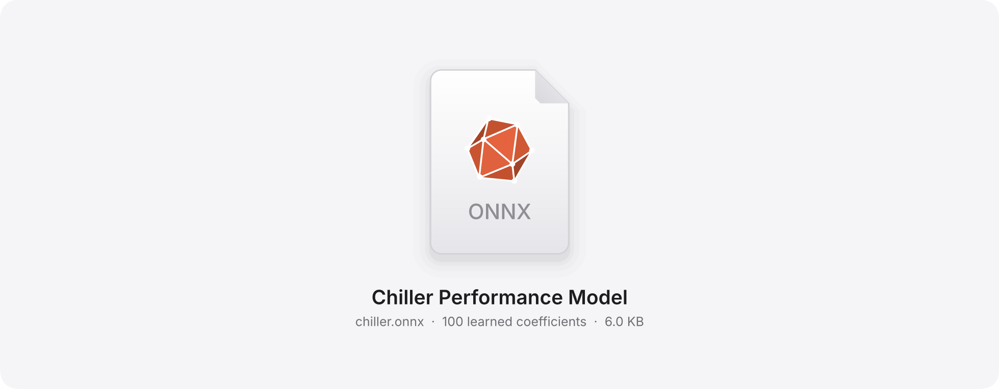
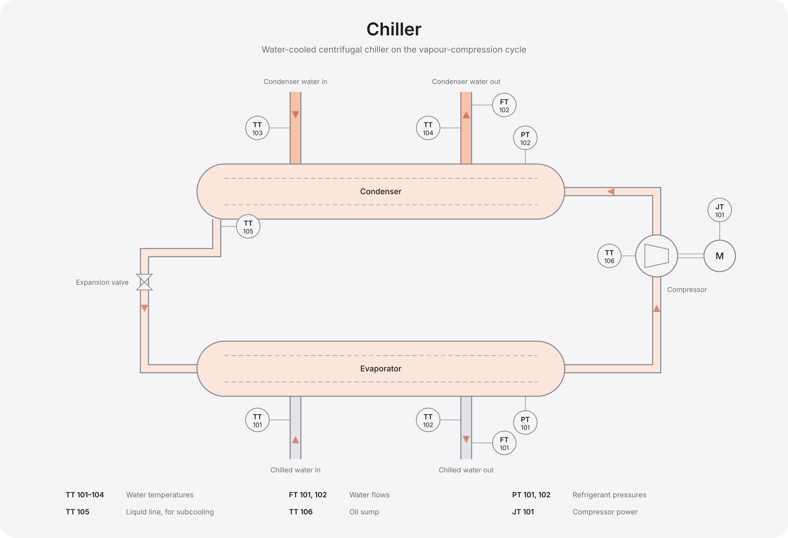
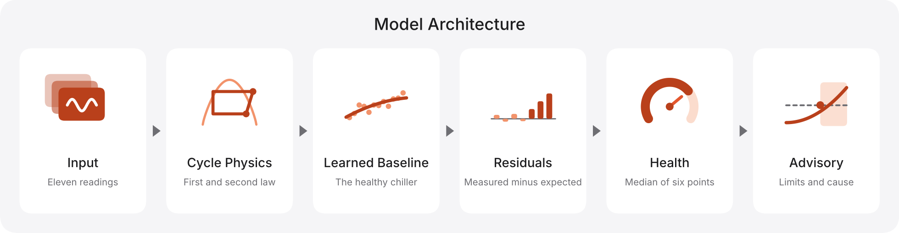
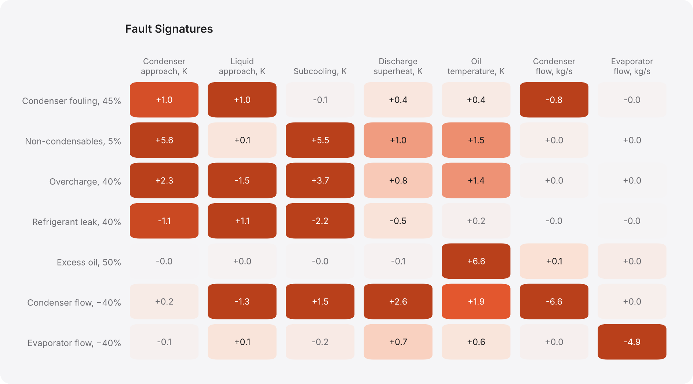
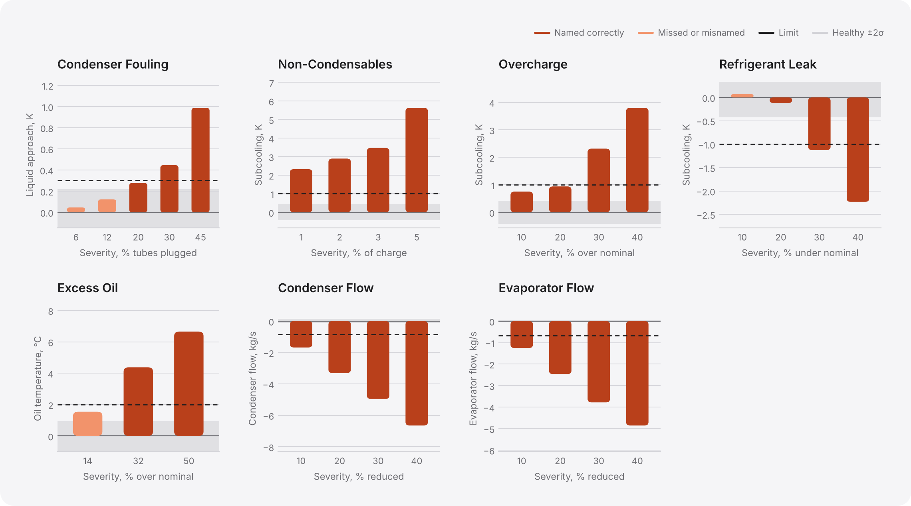

# Chiller Performance Diagnosis

<picture>
  <source media="(prefers-color-scheme: dark)" srcset="docs/model-dark.png">
  
</picture>

Chiller Performance Diagnosis watches a water-cooled centrifugal chiller through the instruments a plant room already has, and says which part of the refrigeration cycle has drifted from health and why. It reads the cycle with the first and second laws and R-134a's saturation properties, compares each health parameter with a learned model of the healthy chiller at the same load and water temperatures, and names one of seven faults: condenser fouling, non-condensable gas, refrigerant overcharge or leak, excess oil, and low condenser or chilled-water flow. On the laboratory tests of ASHRAE research project 1043, it raised no advisory across 187 hours of healthy operation, detected 25 of 28 fault tests and named the cause correctly in 24 of them. It runs in 0.02 ms per operating point on one CPU thread.

## The Chiller

<p>
<picture>
  <source media="(prefers-color-scheme: dark)" srcset="docs/chiller-dark.png">
  
</picture>
<br>
<sub><b>Chiller.</b> The vapour-compression cycle runs clockwise. The compressor lifts R-134a vapour from the evaporator to the condenser, where condenser water carries its heat away. The liquid falls through the expansion valve back to the evaporator, where it boils by taking heat from the chilled water. Instruments carry their ISA-5.1 tags.</sub>
</p>

The data comes from ASHRAE RP-1043 (Comstock and Braun, 1999), in which a 90-ton (316 kW) centrifugal chiller was run in a laboratory, healthy and with seven faults at four severities each. Every test steps the chiller through 27 combinations of load, chilled-water setpoint and condenser-water temperature, logging 64 sensors every 10 seconds for about 14 hours. The model reads eleven of them.

| Tag | Measures | Used for |
| :-- | :-- | :-- |
| TT 101–104 | Water temperatures in and out of each heat exchanger | Heat duties, operating conditions, approaches |
| FT 101, 102 | Chilled and condenser water flow | Heat duties, flow faults |
| PT 101, 102 | Evaporator and condenser refrigerant pressure | Saturation temperatures |
| TT 105 | Liquid line temperature | Subcooling |
| TT 106 | Oil sump temperature | Lubrication |
| JT 101 | Compressor power | COP |

## How It Works

<picture>
  <source media="(prefers-color-scheme: dark)" srcset="docs/architecture-dark.png">
  
</picture>

**Input.** The mean of eleven readings over a steady stretch of operation. A stretch is steady when chilled-water temperature, condenser-water temperature and power have held still for five minutes.

**Cycle physics.** Heat duties from the first law on each water circuit, condensing and evaporating temperatures from the refrigerant pressures, COP, the Carnot COP between those temperatures, and the health parameters each fault moves.

**Learned baseline.** A healthy chiller's parameters also move with load and the two water temperatures. A polynomial in those three conditions, fitted on the healthy tests, says what each parameter should read at every operating point.

**Residuals.** Measured minus expected, for five parameters: liquid approach, subcooling, oil temperature and the two water flows.

**Health.** The median residual over the last six steady points, about three hours of operation, in K, °C and kg/s.

**Advisory.** One limit per parameter in engineering units, held for two windows in a row. The cause is the fault whose signature the residuals point along most closely.

Properties, cycle, baseline and residuals run as one ONNX graph, `models/chiller.onnx`. Finding steady stretches, the window and the limits are a few lines of state in the host loop, `src/monitoring/monitor.py`.

## The Physics

**Heat duties.** The steady-flow energy equation for water through a heat exchanger, with no work and $h_{out} - h_{in} = c_p (T_{out} - T_{in})$ for a liquid, gives

$$\dot{Q}_{evap} = \dot{m}_e\, c_p\, (T_{e,in} - T_{e,out}), \qquad \dot{Q}_{cond} = \dot{m}_c\, c_p\, (T_{c,out} - T_{c,in})$$

**The cycle as a whole.** The first law on the refrigerant circuit, $\dot{Q}_{cond} = \dot{Q}_{evap} + \dot{W}$, checks the sensors against each other. On this chiller the condenser carries away 10% less than the sum, steadily, with a spread of 2.8%. The difference is heat that leaves other than through the condenser water, such as motor and casing losses, and it holds still enough for the check to use it as an offset.

**Efficiency, first and second law.**

$$\mathrm{COP} = \frac{\dot{Q}_{evap}}{\dot{W}}, \qquad \mathrm{COP}_{Carnot} = \frac{T_{evap}}{T_{cond} - T_{evap}}, \qquad \eta_{II} = \frac{\mathrm{COP}}{\mathrm{COP}_{Carnot}}$$

with $T_{evap}$ and $T_{cond}$ the R-134a saturation temperatures, in kelvin, at the measured evaporator and condenser pressures. The healthy chiller runs at a COP of 3.75 on average and a second-law efficiency between 0.14 and 0.49 across its operating points.

**Two condenser approaches.** How far the refrigerant sits above the water leaving the condenser, measured two ways:

$$\Delta T_{sat} = T_{sat}(p_{cond}) - T_{c,out}, \qquad \Delta T_{liq} = T_{liq} - T_{c,out} = \Delta T_{sat} - \Delta T_{sub}$$

where $\Delta T_{sub} = T_{sat}(p_{cond}) - T_{liq}$ is the subcooling. The first uses the temperature the pressure implies, the second the liquid's real temperature. Gas that does not condense adds its own partial pressure (Dalton's law), which raises the condenser pressure and so $\Delta T_{sat}$ and the subcooling together, while the liquid's real temperature and $\Delta T_{liq}$ stay where they were. Fouling raises both approaches equally. A larger refrigerant charge backs liquid up into the condenser, raising subcooling and lowering $\Delta T_{liq}$, and a leak does the opposite. Liquid approach and subcooling together separate all four.

**Saturation for the edge.** CoolProp provides R-134a's properties in Python and matches the laboratory's own saturation temperatures to within 0.05 °C. A property library cannot run in an ONNX graph, so the graph uses the Antoine form

$$T_{sat}(p) = \frac{1}{a - b \ln p} - c$$

fitted to CoolProp over 200 to 1600 kPa, which agrees with it to within 0.04 K.

## The Faults

Each fault was set in the laboratory at four severities. The physics predicts where each one should show, and the data confirms it before anything is learned.

<p>
<picture>
  <source media="(prefers-color-scheme: dark)" srcset="reports/figures/signatures-dark.png">
  
</picture>
<br>
<sub><b>Fault signatures.</b> Each fault at its highest severity, as the mean difference from the five healthy points nearest in load and water temperatures. Colour shows how many healthy test-to-test spreads the difference spans. Fouling raises both approaches by 1.0 K. Non-condensables raise the saturation approach and subcooling by 5.5 K and leave the liquid approach alone. Overcharge and leak move liquid approach and subcooling in opposite directions. Excess oil shows only in oil temperature, and the flow faults in the measured flows.</sub>
</p>

The second-law efficiency is not among the health parameters. At the highest severities it moves by 0.02 or less, against a healthy range of 0.14 to 0.49. On this chiller the faults show in temperatures and pressures well before they show in efficiency.

## Where It Fits

The model is designed for a water-cooled chiller with the instruments a plant room normally has, monitored for faults that develop over days or weeks.

| The situation | The design |
| :-- | :-- |
| The refrigerant and the cycle are known | Properties come from the refrigerant's saturation curve, and only the healthy chiller's behaviour is learned |
| The chiller runs at whatever load and water temperatures the building and the weather set | Every parameter is compared with the healthy chiller at the same three conditions |
| Several faults move the same temperatures | Two approach temperatures and subcooling separate them by direction |
| Readings are noisy between operating points | Only steady stretches are used, and health is the median of six |
| Maintenance is planned by engineers | Health is reported in K and kg/s, and each advisory names a cause |
| A plant controller has a modest CPU | One operating point takes 0.02 ms |

Some situations call for a different design. A chiller with no flowmeters needs the flows inferred from a compressor map before the water-side duties are known. Faults that develop in minutes, such as a failing expansion valve, need dynamic models of the transients this model skips. A different refrigerant needs its own saturation curve, and a different chiller its own healthy baseline.

## How It Performs

The scoring keeps the data each judgement uses away from the data it was learned from. Each healthy test is judged by a baseline fitted without it. Each fault test's cause is named with signatures learned without it.

| Fault | Severities tested | Detected | Cause named |
| :-- | :-- | :-- | :-- |
| Non-condensables | 1, 2, 3, 5% of charge | 4 of 4 | 4 of 4 |
| Overcharge | 10, 20, 30, 40% | 4 of 4 | 4 of 4 |
| Condenser flow | 10, 20, 30, 40% reduced | 4 of 4 | 4 of 4 |
| Evaporator flow | 10, 20, 30, 40% reduced | 4 of 4 | 4 of 4 |
| Refrigerant leak | 10, 20, 30, 40% | 4 of 4 | 3 of 4 |
| Condenser fouling | 6, 12, 20, 30, 45% of tubes | 3 of 5 | 3 of 3 |
| Excess oil | 14, 32, 50% | 2 of 3 | 2 of 2 |
| Healthy, 14 tests, 187 hours | | 0 advisories | |

<p>
<picture>
  <source media="(prefers-color-scheme: dark)" srcset="reports/figures/health-dark.png">
  
</picture>
<br>
<sub><b>Health at each severity.</b> The mean residual of each fault's main parameter over its test, against the advisory limit (dashed) and the healthy ±2σ band. Dark bars are tests whose advisory named the right cause. Every miss is at a severity whose effect is close to the healthy spread: 6 and 12% of condenser tubes plugged, 14% excess oil, and a 10% leak whose subcooling had barely moved and which was named as overcharge.</sub>
</p>

## How It Was Built

**Steady points found in the raw signals.** The laboratory files carry their own summary of 27 steady points per test, but a plant's monitor has to find steady operation itself. A stretch counts as steady when the chilled-water and condenser-water temperatures and the power each stay within a tight spread for five minutes. This finds 27 to 32 points per test, 1,210 across the 42 tests used.

**The physics checked before it was used.** Saturation temperatures from CoolProp agree with the laboratory's to within 0.05 °C, so the property calculations stand. Each fault's signature was then checked against what the cycle predicts, which is how the liquid approach earned its place: with the saturation approach alone, non-condensables and overcharge look alike.

**The learned baseline, judged a day at a time.** Each parameter is a polynomial in load, chilled-water setpoint and condenser-water temperature, fitted by least squares. Its degree is chosen by leaving out one whole healthy test at a time, the smallest degree that cuts held-out error by more than 2%. Degree 3 won. Leaving out whole tests, not random points, matters because neighbouring points from one test share that day's conditions and would flatter the fit. The held-out spread is 0.11 K on liquid approach, 0.21 K on subcooling and 0.48 °C on oil temperature.

**Signatures learned from the faults, scored without them.** Each fault's signature is the direction it moves the five residuals, in units of their healthy spread, averaged over its tests. The cause of each fault test is named with signatures learned from all the other tests, so no test helps name itself.

**A median, after a mean failed.** Health was first the mean of the last six points. A test showed that one odd point, five spreads out, lifted six windows running past the limit and raised an advisory by itself. The median of six cannot be moved by one point, and with it the scores improved by one detection and one correct cause.

**Limits in engineering units.** 0.3 K of liquid approach, 1 K of subcooling either way, 2 °C of oil temperature and 5% of design water flow.

## How to Use It

The model is released in `models/` as `chiller.onnx` (6 KB), with the healthy baseline in `baseline.json` and the fault signatures and healthy spreads in `signatures.json`. Running it needs NumPy, pandas and ONNX Runtime.

### Installation

```bash
git clone https://github.com/iamabdirazak/chiller-performance-diagnosis.git
cd chiller-performance-diagnosis
python3 -m venv .venv && source .venv/bin/activate
pip install -r requirements.txt
python -m pytest -q
```

### Monitoring a Chiller

```python
from src.monitoring.monitor import Monitor

monitor = Monitor()                      # loads models/chiller.onnx and models/signatures.json

while running:                           # every 10 seconds
    monitor.step({
        "evaporator_in": 12.4, "evaporator_out": 6.9,        # °C
        "condenser_in": 29.4, "condenser_out": 34.1,         # °C
        "evaporator_flow": 13.6, "condenser_flow": 16.8,     # kg/s
        "evaporator_pressure": 352.0,                        # kPa absolute
        "condenser_pressure": 905.0,                         # kPa absolute
        "subcooling": 3.6,                                   # K
        "oil_temperature": 44.8,                             # °C
        "power": 61.5,                                       # kW
    })
    print(monitor.health, monitor.efficiency, monitor.advisory)
```

For another chiller, the healthy baseline is refitted on its own healthy operation with `python -m src.models.train`.

### Reproducing the Results

The data is the original RP-1043 laboratory files, published on figshare. They are not redistributed here.

```bash
mkdir -p data && cd data
curl -L --compressed -o rp1043.zip -A "Mozilla/5.0 (Macintosh; Intel Mac OS X 14_0) AppleWebKit/605.1.15" \
  -H "Referer: https://figshare.com/" "https://ndownloader.figshare.com/files/52432007"
unzip -q rp1043.zip && mv "Chiller Data" raw && cd ..

python -m src.data.prepare               # steady points, into data/steady.parquet
python -m src.models.train               # healthy baseline and fault signatures
python -m src.evaluation.score           # into reports/results.json
python -m src.deployment.export          # models/chiller.onnx
python -m src.deployment.verify          # agreement and latency
for f in signatures health diagrams; do python -m src.visualization.$f; done
```

Everything runs on a CPU in under a minute.

## Limitations

- One chiller, in a laboratory. A field chiller sees slower and messier changes in load and water temperature than the laboratory's 27 set points, and its baseline would be fitted on its own healthy weeks.
- Each test holds one fault. The dataset's one compound test, both water flows reduced together, was left out, and the rules have not been tested on two faults at once.
- The water flows are measured directly, which makes the two flow faults the easiest. Many plants have no chilled-water or condenser-water flowmeter.
- The healthy tests come from a few months of one test programme, including an adjustment of the oil pressure regulator. A chiller's healthy behaviour drifts over seasons, and the baseline would need refitting as it does.
- Times are measured on a general-purpose CPU, not on a plant controller.

## License

The code is released under the MIT License. The RP-1043 data belongs to ASHRAE and is not included.

## Author

Abdirazak Mubarak, November 2026
